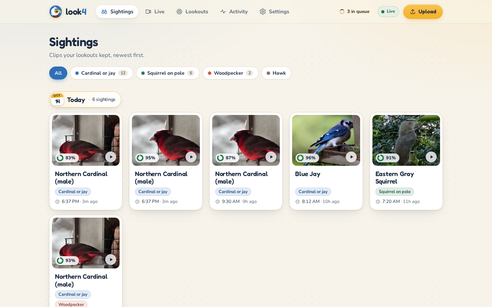
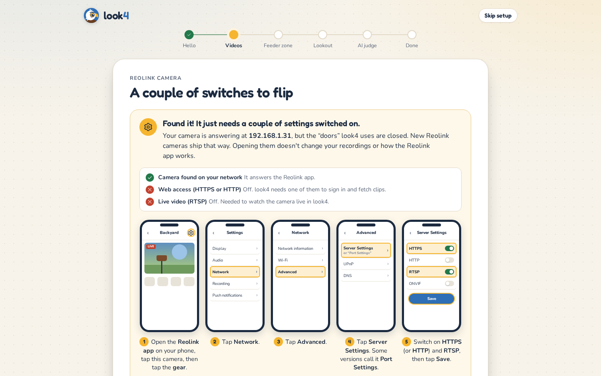

<p align="center"></p>

**look4 watches your camera's clips so you don't have to.** Describe what you want to see in plain
English ("a cardinal or blue jay at the feeder"). look4 pulls every motion clip off the camera,
keeps the ones that match, and shows them in a local web app. A run of cheap local checks means
the spotter, the only part that costs money, only ever looks at a few frames from a few clips.

Built for a Reolink RLC-823S1 pointed at a bird feeder, but it works with any video: other IP
cameras over RTSP, a folder, drag-and-drop uploads, or files on the command line.

<p align="center">
  
  
</p>

- [Quick start](#quick-start)
- [Desktop app](#desktop-app)
- [Connecting a Reolink camera](#connecting-a-reolink-camera)
- [Live view and camera controls](#live-view-and-camera-controls)
- [Other video sources](#other-video-sources)
- [Lookouts](#lookouts)
- [Life list](#life-list)
- [How look4 keeps it cheap](#how-look4-keeps-it-cheap)
- [Getting more accurate over time](#getting-more-accurate-over-time)
- [CLI reference](#cli-reference)
- [Configuration](#configuration)
- [Data on disk and retention](#data-on-disk-and-retention)
- [Troubleshooting](#troubleshooting)
- [Development](#development)
- [Credits](#credits)

## Quick start

You need **Node 23.6 or newer** (look4 runs its TypeScript directly, with no build step),
**ffmpeg**, and **pnpm**.

```sh
sudo apt install ffmpeg      # or: brew install ffmpeg
pnpm install
pnpm start
```

`pnpm start` prints a URL (http://127.0.0.1:4040) and opens it in your browser. On the first run,
the page is a setup wizard with one question per screen:

1. **Videos.** Where clips come from: a Reolink camera (the wizard finds it on your network), a
   folder, a camera stream, or "I'll upload them".
2. **Feeder zone** (optional). Draw a box on a real frame around the part that matters. Motion
   outside it is ignored.
3. **Lookout.** Say what to look for, or pick an example.
4. **Spotter.** Claude takes the last, close look and makes the call; this step shows what it costs.

**You don't need an API key if Claude Code is installed and logged in** (`claude` on your PATH):
the spotter looks through that login, and the calls count against your Claude subscription rather than
being billed. Otherwise, paste an Anthropic API key in the spotter step. It is saved to `.env`.

The first start also builds the web UI (a few seconds) and downloads the detector model, about
158 MB, into `data/models/`. Both happen once.

To leave look4 running, keep the terminal open or run `pnpm start` under your usual process
manager. Ctrl-C stops it cleanly.

## Desktop app

```sh
pnpm desktop                  # look4 in its own window, onto whichever look4 is running
```

A window onto the UI `pnpm start` serves, to keep open all day. When no look4 answers (on 4040,
then Vite's 5173), the window starts one itself, `look4 start --no-open` in this folder, with its
output in `data/desktop-server.log`. That server keeps running when you close the window, since it
is what pulls clips off the camera; stop it with `pkill -f "src/cli/main.ts start"`. A server you
started yourself is joined, never replaced, and the window reconnects when it restarts.

On WSL it runs the **Windows** build of Electron, natively, so it gets a real taskbar button. The
first launch adds a **look4** shortcut to the Start Menu; right-click the taskbar button and choose
**Pin to taskbar**. The pinned look4 opens without a terminal, from
`%LOCALAPPDATA%\look4\desktop`, which every `pnpm desktop` refreshes. `pnpm desktop --wslg` runs
the Linux build through WSLg instead.

The window remembers its size, position and page. Links to other sites open in your browser.

## Connecting a Reolink camera

look4 keeps the moments where something moves: it watches the camera's preview stream itself and
also uses the camera's own motion detection. You don't need to change any recording or motion
settings. Clips come from one of two places (**Settings → Sources → Edit** chooses; `capture` in
the config):

- **The live stream** (when RTSP is on and the camera has a password). look4 records the stream in
  6 s pieces. It also watches the camera's small preview stream (4 frames a second at 320×180)
  for anything at least ~6 px that keeps moving, anywhere in view; light changes, IR switches and
  the camera moving don't count. That costs about 2% of one CPU core. And it asks the camera about
  once a second whether it sees motion (`GetMdState`, and its person/vehicle/animal detection where
  it has one). Whenever look4 or the camera sees motion, that becomes one clip, from 4 s before it
  to 8 s after (moments under ~13 s apart share one), split at 2 minutes, with sound. Everything
  else goes to `data/unchecked/` and is deleted after two days, or sooner once it passes 10 GB
  (`retention.uncheckedGb`). If look4's
  watch can't run, the camera's motion decides; if neither can be read, look4 checks everything
  rather than miss something. This is steadier than the SD card, needs no card, and is what Record
  on the Live page uses.
- **The SD card.** Every 60 s look4 asks the camera's web API what new recordings are on its
  microSD card and downloads them, starting with the last 24 hours.

**Automatic** (the default) uses the live stream when it can, and otherwise the SD card until RTSP
is turned on. The source's line in **Settings** says which one it is using and why.

**Why not run look4's own checks on all of it?** The detector took about a minute per 30 s of
footage on this project's machine, so checking the stream around the clock falls behind real time.
Watching the preview stream for movement is cheap; look4's detector and spotter then check only the
moments something moved. On a busy, windy day that is most of the daytime (85% of a sunny noon on
this project's camera), so the detector can fall behind in busy hours. "Check: Everything"
(`motionGate: "all"`) runs the full checks on all of it, and "Only what the camera flags"
(`motionGate: "camera"`) runs nothing extra on your computer.

**If the camera misses small birds.** The default **Check**, "Anything that moves"
(`motionGate: "both"`), already covers it: look4's own watch catches the small birds the camera's
detection misses (on this project's camera, the camera flagged none of four bird visits in a
3-minute check; look4's watch caught all four). The source's line in **Settings** shows both counts,
"motion today: look4 saw it N times, the camera M". There's no need to change the camera's motion
settings. To re-check a stretch nobody flagged, run `pnpm look4 scan data/unchecked/<date>`.

The wizard does this:

1. **Find it.** "Find it for me" scans your local network (about 3 s) and recognizes Reolink
   cameras by their network-card maker. You can also type the address.
2. **Check the door before knocking.** It probes the camera's ports *before* it tries a
   password, because a Reolink camera locks you out for a while after a few wrong passwords.
   look4 never spends a login attempt on a camera that can't answer one.
3. **Sign in** and show you what it found (model, firmware, name).
4. **Save.** The address goes in `look4.config.json` and the password in `.env`, which only you
   can read. The password never goes in the config file and is never logged.

**HTTPS is switched off on new cameras.** Recent Reolink firmware ships with its HTTP and HTTPS
servers off, so look4 can see that the camera is there but can't talk to it. The wizard spots this
and walks you through the fix, with pictures:

> Reolink app → tap the camera → **gear** → **Network** → **Advanced** → **Server Settings**
> (some versions say **Port Settings**) → switch **HTTPS** (or **HTTP**) and **RTSP** on → **Save**.

HTTPS or HTTP: either works. look4 accepts the camera's self-signed certificate, and plain HTTP is
fine on a home network. RTSP is only needed for [live view](#live-view-and-camera-controls). The
wizard shows which of the camera's ports answer (9000 app, 443/80 web, 554 live video), and a wrong
password screen counts down the tries the camera allows before it locks; look4 never retries a
refused password by itself.

The Reolink desktop program has the same switch under the camera's Settings → Network → Advanced →
Server Settings. Turning it on doesn't change your recordings or how the Reolink app works. Keep
the wizard open: it checks again every few seconds and moves on as soon as HTTPS answers.

**The password.** A Reolink camera comes with the username `admin` and **no password**. If you
never set one, leave the box empty (in `.env`, `REOLINK_PASSWORD=` with nothing after it means
blank). It's the camera's own password, not your Reolink cloud account's.

**Why pull over HTTPS instead of having the camera FTP its clips?** Pulling needs no camera
setup beyond one switch, and the SD card stays the source of truth: if look4 is down for a day,
it catches up from the card. FTP would need an FTP server, and on WSL2 a port forward from Windows
into the Linux VM, while WSL2 can already reach the LAN outbound. If you prefer FTP anyway, point
the camera's FTP upload at a folder and add that folder as a source (next section).

## Live view and camera controls

The **Live** page plays any Reolink or RTSP camera, one to three seconds behind real time.

- **Sharp** (the default) is the camera's main stream. A browser that plays HEVC (desktop Chrome,
  Android Chrome) gets the 4K HEVC stream copied as is: about 2 Mbps for a garden scene and almost
  no CPU on the computer running look4. Browsers that can't (Edge without Microsoft's HEVC Video
  Extensions) get it re-encoded to 1080p H.264 on an NVIDIA GPU at 2.5 Mbps. Without NVENC, Live
  opens on Quick, because no CPU here re-encodes 4K in real time. Live never switches to Quick
  by itself: that is always your pick.
- **Quick** (<kbd>Q</kbd> switches) is the sub stream: 640×360 on an RLC-823S1, about 50 kbps. The
  old picture stays up until the new stream plays.
- **Sound** (<kbd>M</kbd>) plays the camera's microphone. When the microphone is off, the sound
  button offers the switch.
- **Layout.** The controls sit beside the picture, or below it on a narrow window; drag the divider
  between them to resize (double-click it, or <kbd>Enter</kbd> on it, for automatic). **Theater**
  (<kbd>T</kbd>) makes the picture as large as the window allows without going full screen;
  <kbd>F</kbd> is full screen and <kbd>C</kbd> shows or hides the controls.
- **Zoom** with the wheel where the pointer is. By default the camera's lens zooms first: from the
  first notch the part it is going to stays sharp while the rest blurs, the spot under the pointer
  stays put, and once the lens is in as far as it goes the picture magnifies. Over the picture the
  wheel only zooms; scroll the page from outside it. "Wheel: magnify first" in ⋯ More instead magnifies at once and
  hands that to the lens when the wheel stops (the picture holds still while it moves). A pinch
  or <kbd>Ctrl</kbd>+<kbd>+</kbd> only magnifies; drag to look around, and "Zoom camera here"
  hands the magnified view to the lens. **Aim** (<kbd>A</kbd>, or Shift-drag)
  points the camera: drag a box to frame it, or click a point to center it.
- **Record** (<kbd>R</kbd>) saves from 10 s *before* the press until you press it again (5 min at
  most). The clip is pinned: it is kept, marked "Saved from Live", whatever the lookouts decide.
  This needs the camera's clips to come from its live stream (see below).
- **Camera controls** come from what the camera reports (`GetAbility`), and a control it lacks is
  not shown: hold-to-move pan and tilt (<kbd>Shift</kbd> for slow; a held move stops by itself
  after 8 s if the release never arrives), zoom and focus, **saved views** with pictures (save,
  rename, update, delete; <kbd>1</kbd>–<kbd>9</kbd> go to them), **Home** (the camera's guard
  position, with auto-return after 1–5 min), night picture and night vision, the spotlight and its
  brightness, auto-tracking, and the siren (hold **Shoo** for a second).
- **Pop out** (<kbd>P</kbd>) floats the picture in an always-on-top window where the browser
  supports it (Chrome, Edge), else a plain small window; tile it anywhere. **Snapshot**
  (<kbd>S</kbd>) downloads the camera's own full-resolution still.
- Browsers without Media Source Extensions get the stream as Motion JPEG. A camera whose RTSP is
  off shows a fresh picture every second from its web API, next to the steps to turn RTSP on.

**Zoom in on birds** (off by default; **Settings → Sources → Edit**, `closeUps` in the config).
When look4's motion watch sees something move, it takes a still from the camera and the detector
checks the moving spot for a bird. If there is one, the camera frames it optically (the bird plus
its own size again on every side, as far as the lens goes: 2.5× on an RLC-823S1), waits for the lens to stop and focus,
takes three full-resolution stills, goes back Home, and keeps the sharpest. That close-up is the
first picture on the clip's page and on its Sightings card. It needs clips from the live stream
with **Check: Anything that moves**, a saved Home view, and a camera that can frame a box; the
switch only shows on cameras that can. It looks at most every 8 s and rests a minute after each
close-up, holds off for two minutes after anyone steers the camera on the Live page (and hands
the camera straight over if they do mid-zoom), and skips while the camera is moving, tracking on
its own, or pointed away from Home. Otherwise the camera always goes back Home, also after an
error or when look4 stops; the camera's own Home auto-return is a second safety net. The zoomed-in
seconds land inside the clip that set it off.

**Keyboard shortcuts.** Press <kbd>?</kbd> on any page for the list. Every shortcut can be changed
there: click it and press the new keys (a key already in use swaps with it). Changes are saved in
this browser. Arrow keys pan and tilt, <kbd>+</kbd>/<kbd>-</kbd> zoom the camera, <kbd>[</kbd>/<kbd>]</kbd>
focus, <kbd>H</kbd> goes home, <kbd>L</kbd> toggles the spotlight, <kbd>Z</kbd> shows the detection
zone and <kbd>N</kbd> goes to the next camera. Shortcuts never fire while you type in a box.

**Reolink live video needs a camera password.** Reolink refuses RTSP while the camera has none, so
with a blank password the Live page explains how to set one (Reolink app → camera → gear →
Advanced → User Management) and shows stills meanwhile.

**Watching from away from home: use [Tailscale](https://tailscale.com).** Install it on the
computer running look4 and on your phone, signed in to the same account. Set `server.host` to
`0.0.0.0` in `look4.config.json` and restart look4, then open
`http://<the computer's Tailscale name>:4040/live` on the phone. **Never port-forward the camera
(or look4) on your router**: that puts the camera's login on the open internet, where bots try
passwords around the clock, and look4 has no login of its own.

**Sighting notifications come to a computer, not a phone (yet).** They show while look4 is open
in a browser tab or the desktop app; allow them in **Settings → Alerts**. Phones don't get them:
Android Chrome only shows notifications from a service worker, which look4 doesn't have yet, and a
phone freezes a tab in the background anyway.

**Checking a camera from the terminal.** `node scripts/check-camera.ts 192.168.1.31` lists which
ports answer and how to turn the missing ones on; it never signs in. Add `--login` to sign in once
with `REOLINK_PASSWORD` from `.env`, read (never change) the camera's controls and presets, and
probe the RTSP sub and main streams with ffprobe. A refused password stops it at once.

## Other video sources

All of these feed the same pipeline. Add them in the wizard, in **Settings → Sources**, or with
`look4 init`.

| Source | What it is |
|---|---|
| **Upload** | Drag videos onto the web app, or use the **Upload** button. |
| **Inbox** | Anything dropped in `data/inbox/` is taken in (moved). Always on. |
| **Folder** (`watch`) | Any directory something else writes to: an FTP target, an NVR export, a phone sync. Files are copied once their size stops changing. |
| **Stream** (`rtsp`) | Any IP camera's RTSP (or HTTP/RTMP) stream, recorded in 30 s segments (`segmentSeconds`), with sound. All of it goes through the motion gate, about 2,880 segments a day, so use the camera's low-resolution sub-stream. A Reolink camera is better added as **A Reolink camera**, which records only the moments look4 or the camera sees motion. |
| **`look4 scan`** | One-off: process files, folders or globs now and print a table. |

Every clip is dated from its file name when it has one (Reolink SD and FTP names, ISO stamps),
otherwise from the file's modified time. Identical files are taken in only once.

## Lookouts

A lookout is one thing you want to see, in your own words. You can run several at once, and each
clip is checked against all of them in one go. Your lookouts sit in a row at the top of Sightings:
pick one to see only the clips it kept and to tune its threshold, and pick it again for the whole feed.

```
a northern cardinal at the feeder
a blue jay at the feeder
any squirrel on the feeder or the pole
a hawk or any other bird of prey
a woodpecker
```

When you add a lookout, a language model turns it into two things:

- **detector nouns**: the generic objects the local detector searches for (`bird`, `squirrel`).
- **a spotter checklist**: what the spotter has to see, with field marks for species (a cardinal's
  crest and red plumage, say).

To see what a prompt turns into without saving it, run
`pnpm look4 compile "a cardinal or blue jay at the feeder"`.

Each lookout has a **threshold** (default 0.6): it keeps a clip when the spotter says "yes" with at
least that confidence. To check clips that are already on disk against a new lookout, run
**backfill** (**Look back 7 days** in its menu, or `pnpm look4 lookout backfill <name>`).

## Life list

Sightings keeps your life list, every bird species seen at your camera, in a panel above the feed.
The spotter names the species of every bird it checks, so a lookout can ask for what is new:

```
any bird not on my life list
```

Don't copy the species into the prompt. The lookout follows the list as it grows. look4 itself
decides what is new, not the spotter: a clip is kept only when the spotter names a species missing
from the list (or, if the prompt asks, one you added by hand without a clip) and is at least 75%
sure of it, and a second model (`pipeline.judge.confirmModel`, Claude Opus 5.5 by default), shown the
same images, names the same species at 75% or more. Nearly every bird at a feeder is a regular, so a
coin-flip call of a new species is usually a regular seen badly. The second look costs one more call,
only on the few clips that would become a sighting.

- **Add a bird** from the panel's box: its common name and, optionally, the day you first saw it.
- **Confirm a sighting** with the button on its card (or on the clip page). That says "yes" for
  every lookout that kept it and adds its bird to the life list if it isn't there yet, dated by the
  clip. A card whose bird is new says **New species** and **Confirm + add**. When the spotter only
  said "bird", Confirm asks which one (optional).
- **Wrong bird** on a card says the spotter got it wrong, and asks what it really was (optional). The
  card leaves the feed (**Undo** brings it back) and the clip is kept as ground truth. Before the
  next sighting, the confirming model is shown confirmed photos of the regulars the bird is likeliest
  to be (what you said such a call really was, then the regulars in the clip, then your commonest),
  with your past corrections, so "a male cardinal from behind was called House Finch" is not repeated.
- Each species shows how many clips the spotter has named it in (kept or not). Removing one (its ×)
  makes it new again.

## How look4 keeps it cheap

Almost every motion clip is wind, shadows or light changes. Each stage is cheaper than the next,
and each one drops most of what it sees:

| Stage | Where it runs | Cost | Drops |
|---|---|---|---|
| 0. Motion watch (live, Reolink stream capture) | ffmpeg + pixel maths on the camera's preview stream, local | free · ~2% of one core | the quiet time between visits, to `data/unchecked/` |
| 1. Motion gate | ffmpeg + pixel maths, local | free · 0.4–1.4 s per 720p clip | still clips, light changes, IR switches, noise |
| 2. Detector (OWL-ViT B/32, q8) | your CPU, local | free · **~0.5 s per view** uncontended | clips with nothing matching any lookout's nouns |
| 3. Spotter (Claude Haiku 5.5) | API, or your Claude Code login | **$0.0004–0.0011 per checked clip** | the wrong species, look-alikes, false detections |
| 4. Escalation (optional) | a stronger model | only on close calls | — |

Measured on this project's test clips:

- In the full pipeline run (10 clips pulled from a mock camera), only 7 of 10 reached the spotter.
  The spotter and lookout compiler made 17
  model calls between them, for **$0.012–0.013 in total**. Real feeder footage should drop far more clips
  before the spotter, because most real motion clips have nothing in them.
- A checked clip costs $0.0004–0.0011 at Haiku 5.5's API prices ($0.10 per million input tokens,
  $0.50 per million output). Most of that is the images: up to 4 close-up crops of 512 px plus one
  wider context frame. At the high end, **1,000 checked clips cost about $1.10**.
- Through the Claude Code login it costs nothing extra. look4 still shows what each call *would*
  have cost on the API, so you can compare.
- Spotter latency is about 4–6 s per clip through Claude Code, two clips at a time.
- A detector "view" is one image the model looks at: the zone, plus a close-up around each moving
  thing. A clip uses 6–15 views, and stops early once every noun has a confident hit. When a clip
  moved but nothing was found, a **second look** tiles the zone into close-ups (up to 16 more views,
  about +8 s), because a half-hidden squirrel behind wind-blown leaves scores near zero at full
  frame.

Clips the motion watch or the camera's own detection made skip stage 1's "too little moved" drop:
over a wide view a sparrow is as small a change as a swaying leaf, and they already had something
move in them. Stage 1 still runs on them to pick the detector's frames and close-ups.

The **Activity** page shows the funnel (how many clips each stage dropped) and what was spent today,
this week and in total. Every rejected clip records which stage dropped it and why, in one sentence.

The reasons behind these choices, with the benchmarks, are in [docs/decisions.md](docs/decisions.md).

## Getting more accurate over time

- **Label sightings.** "Yes, that's it" / "Not this" on a clip page, or **Confirm** / **Wrong bird**
  on a card. A "no" also hides the clip from Sightings, and a Wrong bird's real species is shown to the
  confirming model from then on (see [Life list](#life-list)).
- **Mark misses.** On **Activity**, a rejected clip has "This should have matched".
- **Labeled clips are never deleted** by retention. They become your test set.
- **Measure.** `pnpm look4 eval` re-runs the current pipeline on every labeled clip and prints
  precision, recall and F1 for each lookout, plus which stage dropped each miss. `--no-rerun` scores
  the stored verdicts instead (instant and free).
- **Re-sort with the threshold.** Moving a lookout's threshold slider re-decides every clip that
  lookout has already checked: close calls that were rejected become sightings, and weaker ones
  leave. This costs nothing, because the spotter's answers are stored.

## CLI reference

After `pnpm install` the CLI runs as `pnpm look4 <command>` (the package is private, so no `look4`
lands on your PATH). Its own hints are printed in that same form. Exit codes: 0 ok, 1 a check
failed, 2 a usage error.

```
pnpm start [--no-sources] [--port N] [--no-open]
    Sources + worker + web UI. --no-sources runs only the inbox.

pnpm look4 init [--reolink <host>] [--user admin] [--watch <dir>] [--rtsp <url>] [--lookout "<prompt>"]
    The terminal version of the setup wizard. Asks questions when run in a terminal; the flags are
    for scripts. Writes look4.config.json (+ look4.schema.json) and secrets to .env.

pnpm look4 scan <files|dirs|globs…> [--prompt "<text>"] [--json]
    Copy the files in and process them now; print a result table.
    --prompt runs a one-off lookout (saved disabled, for reuse).

pnpm look4 lookout list
pnpm look4 lookout add "<prompt>" [--name n] [--threshold 0.6]
pnpm look4 lookout rm|enable|disable <name>
pnpm look4 lookout backfill <name> [--since 7d]     (30m, 12h, 7d, 2w or a date)

pnpm look4 compile "<prompt>" [--json]     detector nouns + spotter checklist, nothing saved
pnpm look4 eval [--lookout name] [--no-rerun] [--json]
pnpm look4 doctor                          check node, ffmpeg, config, disk, detector, spotter, sources
pnpm look4 clean                           run retention now
pnpm look4 --help | --version
```

Examples:

```sh
pnpm look4 scan ~/Videos/feeder --prompt "a cardinal"
pnpm look4 lookout add "a hawk or any other bird of prey" --name hawk --threshold 0.7
pnpm look4 lookout backfill hawk --since 3d
LOOK4_CONFIG=/elsewhere/look4.config.json pnpm look4 doctor
```

The CLI and a running `pnpm start` share the same database. A backfill queued from the CLI is
processed by the running app.

## Configuration

Everything has a default, so with no config file look4 still runs (on the inbox and uploads).
The wizard and **Settings** write `look4.config.json` for you. To edit it by hand, keep the
`$schema` line, which gives your editor autocomplete and documentation for every field:

```json
{
	"$schema": "./look4.schema.json",
	"sources": [
		{ "type": "reolink", "name": "feeder", "host": "192.168.1.31" },
		{ "type": "watch", "name": "ftp", "dir": "/srv/ftp/feeder" }
	],
	"pipeline": {
		"roi": { "x": 0.3, "y": 0.2, "w": 0.4, "h": 0.6 },
		"judge": { "model": "claude-haiku-5-5", "escalateModel": "claude-sonnet-5-5" }
	},
	"retention": { "rejectedDays": 7, "minFreeGb": 5 }
}
```

| Key | Default | Meaning |
|---|---|---|
| `dataDir` | `./data` | Clips, database, media, model weights (relative to the config file). |
| `server.host` / `.port` | `127.0.0.1` / `4040` | `0.0.0.0` opens it to your LAN. **There is no login**, so anyone on the network can then change settings. |
| `pipeline.roi` | `null` | The feeder zone, as fractions of the frame. |
| `pipeline.feeders` | `[]` | A box around each hanging feeder. Every checked clip then also shows the spotter each feeder over the whole clip and a close-up of whatever landed on one: small birds clinging still are what the detector misses. |
| `pipeline.motion.*` | 22 / 0.0008 / 0.7 | `pixelThreshold`, `minArea`, `maxArea`; also `sampleFps` 2, `maxFrames` 6. |
| `pipeline.detector.enabled` | `true` | Off: every clip with motion goes to the spotter. |
| `pipeline.detector.model` | `Xenova/owlvit-base-patch32` | Add `:fp32` (or `:q4`, `:fp16`) to choose other weights. The default is q8. |
| `pipeline.detector.threshold` | `0.15` | Minimum detector score. |
| `pipeline.detector.zoom` | `true` | Close-ups on moving areas, plus the second-look tiling. |
| `pipeline.judge.provider` | `auto` | `auto` picks `anthropic` when an API key is set, else `claude-code` when `claude` is installed, else `none` (detector-only verdicts). |
| `pipeline.judge.model` | `claude-haiku-5-5` | |
| `pipeline.judge.escalateModel` / `escalateBelow` | `null` / `0.6` | Ask a stronger model again when the first answer's confidence is in [0.3, 0.6). |
| `pipeline.judge.confirmModel` | `claude-opus-5-5` | A clip a life-list lookout would keep is kept only if this model names the same species at 75%+. `null` skips the check. |
| `pipeline.judge.maxCrops` / `cropSize` | `4` / `512` | Images per checked clip, and their size. Lower both to cut cost. |
| `retention.rejectedDays` / `motionlessDays` / `uncheckedGb` | `7` / `2` / `10` | When rejected clips are deleted, and the most unchecked footage to keep. |
| `retention.minFreeGb` | `5` | Free disk space to keep (see below). |

Reolink sources also take `username` (`admin`), `passwordEnv` (`REOLINK_PASSWORD`), `channel`,
`stream` (`main`/`sub`), `protocol` (`auto`/`https`/`http`), `capture` (`auto`/`stream`/`sd`),
`motionGate` (`both`/`camera`/`all`), `segmentSeconds` (6, from the stream), `pollSeconds` (60) and
`lookbackHours` (24, from the SD card). `alerts.desktop` (`true`) turns sighting notifications on
or off for every browser; each browser also asks its own permission. Changes to thresholds, the zone, motion and spotter settings apply immediately. Switching the
detector on or off, changing its model, `dataDir` and `server` take effect after a restart.

**Secrets live in `.env`** next to the config file (owner-only, mode 600). look4 writes this file
itself:

| Variable | For |
|---|---|
| `REOLINK_PASSWORD` | Camera password. Present but empty means no password. |
| `LOOK4_RTSP_URL` (or whatever `urlEnv` names) | An RTSP URL with credentials. |
| `ANTHROPIC_API_KEY` | The `anthropic` spotter backend. Not needed with Claude Code. |

Other environment variables: `LOOK4_CONFIG` (path to the config file), `LOOK4_LOG`
(`debug`/`info`/`warn`), `LOOK4_HWDEC=off` (turns off NVIDIA GPU decoding of clips at 1440p and
above), `LOOK4_FFMPEG` / `LOOK4_FFPROBE` (binary paths), `LOOK4_CLAUDE_BIN`, and `NO_COLOR`.

## Data on disk and retention

```
data/look4.db                       SQLite: clips, lookouts, detections, verdicts, labels, cost
data/inbox/                         drop videos here
data/clips/<YYYY-MM-DD>/<id>.mp4    every clip taken in, by recording date
data/kept/<YYYY-MM-DD>/<id>.mp4     clips a lookout kept
data/kept/index.jsonl               one JSON line per kept clip
data/unchecked/<YYYY-MM-DD>/        camera footage outside its motion events (stream capture)
data/media/<id>/                    poster.jpg, crop-N.jpg, preview.mp4 (kept clips only)
data/models/                        detector weights (~158 MB)
```

Clip ids are `<YYYYMMDD>-<HHMMSS>-<hash>` from the recording time.

- **Kept clips are kept forever.** Delete them in the UI.
- **Rejected clips** are deleted after 7 days. Clips with no motion at all go after 2 days. The
  database row stays, so the funnel and costs remain accurate.
- **Labeled clips are never deleted**, whatever their status, and neither are clips saved with
  Record on the Live page.
- **Unchecked footage** goes after two days (`motionlessDays`), or sooner once it passes 10 GB
  (`retention.uncheckedGb`), and first when the disk is short.
  To check some of it anyway: `pnpm look4 scan data/unchecked/<date>`.
- **Disk floor.** When free space drops below `retention.minFreeGb` (5 GB), look4 stops taking new
  clips (the camera keeps them on its card, and the source says why) and deletes rejected clips
  early, the ones due to expire soonest first. Kept and labeled clips are never deleted to free
  space.

The cleanup runs hourly while look4 is running; `pnpm look4 clean` runs it now.

## Troubleshooting

Start with `pnpm look4 doctor`. It prints one line per dependency, and for each failure, what to do
about it.

| Symptom | Fix |
|---|---|
| "the camera is there but HTTPS and HTTP are off" | Switch on HTTPS in the Reolink app: camera → gear → Network → Advanced → Server Settings. See [above](#connecting-a-reolink-camera). |
| "wrong username or password" | Factory default is `admin` with **no password**: leave it empty. It's the camera's password, not your Reolink cloud account's. |
| "refusing sign-ins for a while" (lockout) | Too many wrong passwords. Wait about 5 minutes. look4 doesn't retry a password the camera refused until you change it, so it can't extend the lockout. |
| "look4's motion watch isn't running" | look4 can't open the camera's preview stream, so only the camera's own motion makes clips. Check RTSP is on (Reolink app: camera → gear → Network → Advanced → Server Settings) and that the Reolink app or an NVR isn't using all of the camera's streams. If the camera turned down the password, the source says so: use **Fix it**. |
| "camera clock is N min behind this computer" | The camera's time zone or DST setting is wrong, so its recordings carry the wrong time. Fix it in the Reolink app. look4 compensates in the meantime. |
| Clips stuck with "(retry n/3 at hh:mm)" | The spotter hit a timeout, a rate limit, a server error or a Claude subscription usage limit. look4 retries after 2, 8 and 20 minutes, then every few hours until the clip would expire. Nothing to do: the clips go through when the limit resets. |
| "Claude Code … not logged in" | Run `claude` once and log in, or put `ANTHROPIC_API_KEY` in `.env`. |
| First clips take a while | The first run downloads the detector model (~158 MB). Settings and `doctor` show its progress. On a machine with no internet access, copy `data/models/` from another install. |
| "disk nearly full … pulling paused" | Free some space, or lower `retention.rejectedDays`. |
| The UI shows "run pnpm build" | `pnpm start` builds it automatically when vite is installed. Otherwise run `pnpm install && pnpm build`. |
| The clip page says "can't play this format" | The browser can't play HEVC (4K Reolink) originals. Kept clips get an H.264 `preview.mp4`, so this only affects rejected 4K clips. |

## Development

```sh
pnpm dev                      # backend + Vite dev server with hot reload: http://localhost:5173
pnpm dev --no-sources         # same, without starting the camera/folder/stream sources
pnpm dd                       # pnpm dev plus the desktop window onto it (alias of pnpm dev-desktop)
pnpm desktop -- --url=http://127.0.0.1:<port>   # the desktop window onto a particular look4
pnpm test                     # node:test suite (includes real-model tests when weights are cached)
pnpm typecheck                # tsc on the backend and on web/
pnpm build                    # build the web UI into web/dist
pnpm fixtures                 # download + cut the test clips into test/fixtures/videos (~23 MB)
pnpm e2e --mock               # full pipeline against a mock Reolink camera, offline, free
pnpm e2e                      # same with the real spotter (Claude Code login or API key)
pnpm e2e --keep               # keep test/.tmp/e2e/<mode>/ for poking at
node scripts/live-demo.ts     # live view against a fake PTZ Reolink + RTSP camera: http://127.0.0.1:4041/live
                              #   --rtsp-off / --blank-password show those walkthroughs
node scripts/check-camera.ts <host> [--login]   # what live view can reach on a real camera
```

- TypeScript runs directly on Node: relative imports end in `.ts`, and there are no enums or
  namespaces (`erasableSyntaxOnly`).
- Source layout: `src/pipeline/` (motion → detect → judge, `process.ts` ties them together),
  `src/sources/` (reolink, watch, rtsp, inbox), `src/llm/` (anthropic, claude-code, mock backends),
  `src/server/` (Hono API + SSE + media), `src/setup/` (the wizard's discovery and camera checks),
  `src/live/` (live video: ffmpeg MP4/MJPEG feeds, the camera-control interface and its Reolink driver),
  `src/cli/`, `web/` (React + Vite), `brand/` (logo sources and `render.ts`), `desktop/` (the
  Electron window: `src/` is the app, bundled by esbuild in `scripts/dev.ts`, which relaunches it on
  every edit).
- `test/fixtures/mock-reolink.ts` is a fake RLC-823S1 (HTTPS with a self-signed certificate,
  login, search, download, snapshot, lockout mode, PTZ and lights) that the tests and the e2e run use.
  `test/fixtures/mock-rtsp.ts` serves looping video files over RTSP (TCP-interleaved, like a camera). **Never
  point tests at a real camera**: a few failed logins lock it.
- The e2e test needs the fixtures (`pnpm fixtures`) and the cached detector model.
- Test footage and its licenses: [test/fixtures/README.md](test/fixtures/README.md).
- Design decisions and the numbers behind them: [docs/decisions.md](docs/decisions.md).
- Brand assets and usage: [brand/README.md](brand/README.md).

## Credits

- Test footage comes from Wikimedia Commons under PD, CC BY and CC BY-SA licenses. The authors and
  licenses are in [test/fixtures/README.md](test/fixtures/README.md).
- Detector: [OWL-ViT](https://huggingface.co/google/owlvit-base-patch32) (Google), via the
  [Xenova ONNX export](https://huggingface.co/Xenova/owlvit-base-patch32) and transformers.js.
- Spotter: Claude by Anthropic.
- Reolink API request shapes were checked against [reolink_aio](https://github.com/starkillerOG/reolink_aio).
- Fonts: Fredoka and Nunito (SIL OFL).

MIT licensed.
